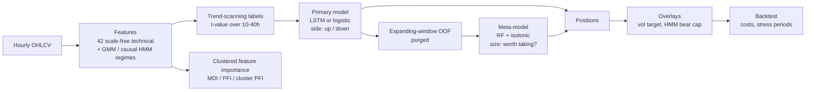

# btc-systematic-ml

[](https://github.com/LeopoldChambriard/btc-systematic-ml/actions/workflows/ci.yml)


**A leakage-aware research pipeline for a long-only systematic Bitcoin strategy**: regime features,
trend-scanning labels, an LSTM directional model with a meta-labeling layer, clustered feature
importance, and a cost-aware backtest, built on the framework of Marcos López de Prado.

It started as a five-person coursework notebook at IMT Atlantique (April 2026). This repository is
the restructured version, and it is deliberately honest about what the notebook got wrong:
an audit found look-ahead in the regime features and several other problems
([`docs/leakage_audit.md`](docs/leakage_audit.md)). Each one is fixed, tested, and the buggy
behaviour is kept behind a config switch so its effect can be measured rather than asserted.

## What this shows

- **Look-ahead control as a first-class concern.** One timing convention, purged validation, HMM
  *filtering* instead of smoothing, training-only fitting everywhere. A test corrupts every price
  after a cut-off date, re-runs the whole signal pipeline, and requires every earlier decision to
  be unchanged ([`tests/test_no_lookahead.py`](tests/test_no_lookahead.py)). The same test is shown to
  *fail* for the legacy HMM mapping.
- **Meta-labeling done properly.** Side (primary model) and size (calibrated meta-model) are
  separated; the threshold is chosen on a chronological hold-out, and if the meta-filter is too
  restrictive the pipeline says so instead of silently falling back.
- **Honest evaluation.** Costs in every number, stress windows through the same engine, a naive SMA
  baseline and a logistic-regression baseline next to the LSTM, a per-strategy table that never
  hides inactive components.
- **Engineering.** Typed config + CLI, vectorised statistics checked against reference loops,
  swappable primary model, CI, reproducible seeds.

## Pipeline



Details of every stage, with the reasoning, are in [`docs/methodology.md`](docs/methodology.md).

## Quick start

```bash
git clone https://github.com/LeopoldChambriard/btc-systematic-ml && cd btc-systematic-ml
pip install -e ".[dev]"          # add ,tf for the LSTM:  pip install -e ".[dev,tf]"

make demo                        # whole pipeline on synthetic data (~1 min, no download)
make test-fast                   # test-suite without TensorFlow
```

The demo checks the install and the plumbing; **its numbers say nothing about markets.**

On real data:

```bash
make data                        # Binance public hourly candles -> data/raw/btc_1h.csv
make baseline                    # logistic-regression primary model (no TensorFlow needed)
make run                         # LSTM primary model (needs `make install-tf`)
make ablation compare            # size of the legacy HMM look-ahead, side by side
```

Every run writes `results/<run_name>/` with `summary.md`, `metrics.csv`, `signals.csv.gz`,
importance tables and figures. All parameters live in [`configs/`](configs/) and can be overridden
from the command line: `sysml run --set primary.type=logreg --set backtest.cost_bps=20`.

## Experiments

| Config | Question it answers |
|---|---|
| [`default.yaml`](configs/default.yaml) | Main run: train 2018-20, test 2021, LSTM primary |
| [`baseline_logreg.yaml`](configs/baseline_logreg.yaml) | Does the LSTM beat a linear model on the same features? |
| [`ablation_leaky_regimes.yaml`](configs/ablation_leaky_regimes.yaml) | How much did smoothing the HMM and mapping it same-day inflate results? |
| [`eval_2022_bear.yaml`](configs/eval_2022_bear.yaml) | Does it survive the 2022 crypto winter without retraining? |

## Results

<!-- RESULTS:START -->
_Not generated yet. Run `make data run readme` (or `make all`) and this block is filled with the
backtest tables of `results/default/summary.md`._
<!-- RESULTS:END -->

Read these with the caveats in mind: one asset, one training window, one test year per run, six
strategy variants compared on that same year (selection bias), flat 10 bps fee, no slippage or
funding, positions above 1× are free leverage. The original notebook's headline figures are not
reproduced here because they are affected by the issues in the audit.

## Repository structure

```
btc-systematic-ml/
├── README.md
├── pyproject.toml            package metadata, dependencies, ruff / pytest config
├── Makefile                  demo, data, run, baseline, ablation, test, lint ...
├── configs/                  YAML experiments (default, baseline, ablation, 2022 test)
├── data/README.md            expected CSV schema and how to get it (data itself is git-ignored)
├── src/sysml/
│   ├── config.py             typed config + command-line overrides
│   ├── data.py               load / validate / split hourly OHLCV
│   ├── download.py           Binance public-data downloader
│   ├── synthetic.py          regime-switching OHLCV for tests and the demo
│   ├── features/
│   │   ├── technical.py      42 scale-free technical features (vectorised)
│   │   ├── regimes.py        GMM + causal HMM (forward filter, one-day lag)
│   │   └── build.py          assemble the 49-column feature matrix
│   ├── labeling/
│   │   ├── trend_scanning.py trend-scanning labels
│   │   └── meta_labels.py    forward / next-bar returns, meta-labels
│   ├── models/
│   │   ├── sequences.py      sliding windows ending at the decision bar
│   │   ├── primary.py        primary-model interface, logistic baseline, factory
│   │   ├── lstm.py           stacked LSTM (TensorFlow, optional)
│   │   ├── validation.py     expanding-window OOF with purging
│   │   └── meta.py           calibrated RF meta-model + hold-out threshold
│   ├── importance/           MDI, PFI, clustered PFI
│   ├── backtest/
│   │   ├── engine.py         long-only engine with proportional costs
│   │   ├── metrics.py        Sharpe, Sortino, Calmar, drawdown, trade stats
│   │   └── strategies.py     sizing, vol targeting, HMM cap, SMA baseline
│   ├── evaluation.py         classification metrics
│   ├── plotting.py           all figures
│   ├── pipeline.py           orchestration (the look-ahead rules live here)
│   ├── reporting.py          run folder + summary.md
│   └── cli.py                `sysml download | run | demo | compare`
├── tests/                    unit, equivalence, causality and end-to-end tests
├── docs/
│   ├── methodology.md        every stage and the reasoning behind it
│   └── leakage_audit.md      what the original notebook got wrong, and how it is guarded
├── notebooks/archive/        the original coursework notebook, untouched (data URL removed)
├── scripts/                  README results updater
└── .github/workflows/ci.yml  lint + tests on 3.10-3.12, plus a TensorFlow job
```

### Where each part of the coursework notebook went

| Notebook section | Code |
|---|---|
| Setup, seeds, determinism | `utils/seed.py`, `models/lstm.py` |
| Data loading and split | `data.py`, `download.py` |
| 1. Feature engineering (technical, GMM, HMM) | `features/technical.py`, `features/regimes.py`, `features/build.py` |
| 2. Labels (trend scanning, meta-labels) | `labeling/trend_scanning.py`, `labeling/meta_labels.py` |
| 3. Models (LSTM, expanding window, meta-model) | `models/primary.py`, `models/lstm.py`, `models/validation.py`, `models/meta.py` |
| 4. Feature importance | `importance/feature_importance.py` |
| 5.1 Classification | `evaluation.py` |
| 5.2 Backtesting | `backtest/engine.py`, `backtest/metrics.py`, `backtest/strategies.py` |
| 5.3 Stress test | `pipeline.run_backtests` driven by `backtest.stress_periods` |
| Figures | `plotting.py` |

## Tests

```bash
make test        # everything
make test-fast   # without TensorFlow
```

The suite checks that vectorised features match the original loop implementations, that features
are scale-free and causal, that the filtered HMM equals the smoother only at the last point, that
labels use only their own window, that the backtest charges costs and aligns bars as documented,
that validation is purged, and, end to end, that corrupting the future leaves past decisions
untouched.

## Limitations

Single asset and split, no walk-forward retraining, execution at the close with a flat fee, no
deflated-Sharpe correction for the number of variants tried. Full list in
[`docs/methodology.md`](docs/methodology.md#11-limitations-and-next-steps).

## Credits

The original notebook was a team coursework at IMT Atlantique (FISE, April 2026) by Jofrey Husson,
Yanis Bendaguir, Stanislas Robineau, Arthur Barbe and Léopold Chambriard. This repository, which
restructures that work into a package and adds the audit, the corrections, the tests and the
tooling, is maintained by [Léopold Chambriard](https://github.com/LeopoldChambriard).

Method references: M. López de Prado, *Advances in Financial Machine Learning* (2018) and *Machine
Learning for Asset Managers* (2020).

## License

MIT, see [`LICENSE`](LICENSE). Nothing here is investment advice.
